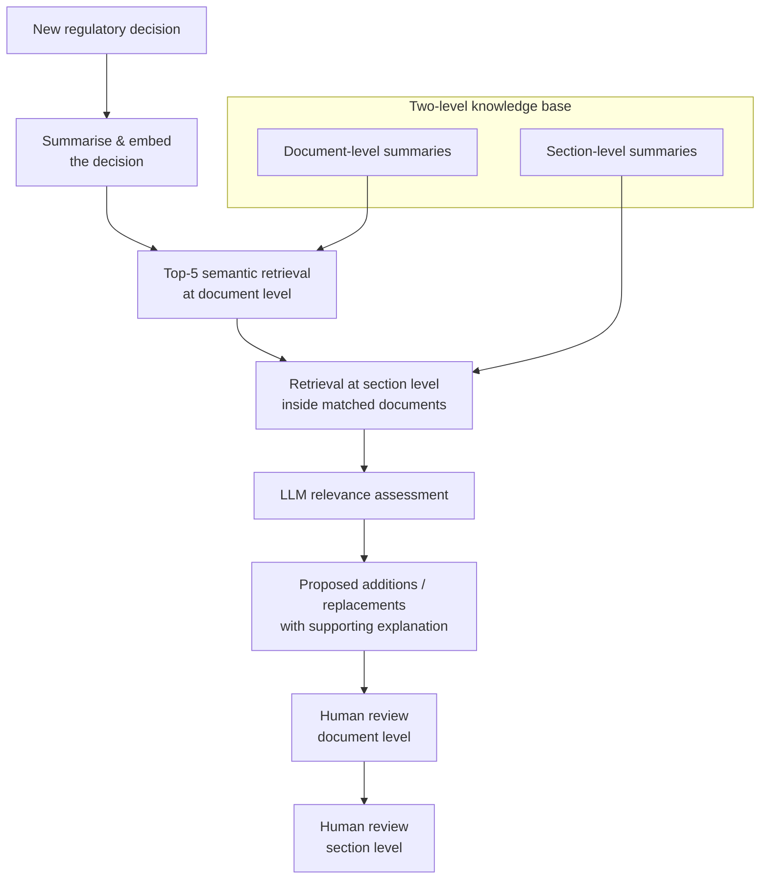

# AI-Powered Regulatory Impact Analysis

**Case study** · Banque Saudi Fransi – AI Factory · AI Engineering Co-op · 2026 · *In progress*

> ⚠️ This repository is a write-up only. The source code, internal policies and all data belong to Banque Saudi Fransi and are confidential, so nothing proprietary is published here. The design below is described at a general level.

## The problem

When the regulator (SAMA) issues a new decision, compliance teams have to work out **which internal policies, documents and specific sections are affected** and what needs to change. Done by hand, that means reading long regulations against a large policy library — slow, repetitive, and easy to miss something.

## The approach

A retrieval-augmented system that narrows the search down and lets an LLM do a first-pass impact assessment, with humans reviewing every result.

### Key design choices

- **Two-level knowledge base.** Policies are summarised at both the document and the section level. Retrieval first finds the right documents, then the right sections, which keeps the LLM's context small and focused.
- **Top-5 semantic retrieval** to keep recall high while limiting what the LLM has to read.
- **LLM relevance assessment** — the model judges whether each candidate section is really affected, then proposes concrete additions or replacements **with an explanation** that points back to the regulation.
- **Human-in-the-loop.** Reviewers confirm or reject at document level and at section level; the system suggests, people decide.

## My contribution

- Built the **initial system skeleton** end to end.
- Designed the **two-level knowledge base** (document- and section-level summaries).
- Implemented the **Top-5 semantic retrieval** and the **LLM relevance-assessment** step that produces proposed changes with explanations.
- Built in the **document- and section-level human review** steps.

## Target impact

- **≈30% reduction in policy impact-assessment effort** (target estimate).

## Skills used

`Python` · `RAG` · `Embeddings` · `Semantic search` · `LLM evaluation & prompting` · `Document summarisation` · `Human-in-the-loop design`

---

**Abdulmohsen Aljomah** · [LinkedIn](https://www.linkedin.com/in/abdulmohsen-aljomah-1398203a8) · [GitHub](https://github.com/abdulmohsenaljomah-ai)
